  
  
  

# 👨‍💻 About Me

 I'm **Gulshan Kumar**, a **B.Tech Information Technology student** passionate about building impactful software with **Artificial Intelligence**, **Machine Learning**, and **Full Stack Development**.

I enjoy transforming ideas into real-world products while continuously improving my problem-solving skills through **Data Structures & Algorithms**.

Currently, I'm focused on developing scalable applications, contributing to open-source projects, and preparing for software engineering internships.

### 🔖 Current Focus

- 🤖 Artificial Intelligence & Machine Learning
- 💻 Full Stack Development
- 📚 Data Structures & Algorithms
- 📱 App Development
- 🌍 Open Source Contribution

---
<h1 align="center">
⚡ Tech Stack
</h1>

<table>

<tr>
<td><b>💻 Languages</b></td>
<td>

</td>
</tr>

<tr>
<td><b>🎨 Frontend</b></td>
<td>

</td>
</tr>

<tr>
<td><b>⚙️ Backend</b></td>
<td>

</td>
</tr>

<tr>
<td><b>🧠 AI / ML</b></td>
<td>

</td>
</tr>

<tr>
<td><b>🗄️ Database</b></td>
<td>

</td>
</tr>

<tr>
<td><b>☁️ DevOps</b></td>
<td>

</td>
</tr>

<tr>
<td><b>🛠️ Tools</b></td>
<td>

</td>
</tr>

</table>

---

# 📊 GitHub Analytics

<!-- Contribution Graph -->

 

# 📈 Contribution Summary

---
# 🐍 Contribution Snake

## 🏆 MY GitHub Trophies

<h1 align="center">
💻 Coding Profile
</h1>

  

<h2 align="center">
🚀 Featured Projects
</h2>

<table align="center">
<tr>
<td width="50%" valign="top">
<h3 align="center"><a href="https://github.com/gulshanverse/TripMates">TripMates</a></h3>

An AI-powered travel platform that connects travelers, builds personalized itineraries, and simplifies group trip planning.

<strong>TypeScript • AI • Travel Tech</strong>

</td>
<td width="50%" valign="top">
<h3 align="center"><a href="https://github.com/gulshanverse/rail-yatra-platform">Rail Yatra</a></h3>

A railway travel intelligence platform for smarter journey decisions, recommendations, optimization, and personalized assistance.

<strong>Python • AI • Travel Intelligence</strong>

</td>
</tr>
<tr>
<td width="50%" valign="top">
<h3 align="center"><a href="https://github.com/gulshanverse/vaani-sutra">Vaani Sutra</a></h3>

A real-time, multilingual AI voice support agent designed for natural customer conversations and intelligent assistance.

<strong>Python • Gemini • VideoSDK</strong>

</td>
<td width="50%" valign="top">
<h3 align="center"><a href="https://github.com/gulshanverse/TrustID-Smart-Identity-Verification-System">TrustID</a></h3>

An AI-assisted identity and document screening platform for faster, evidence-driven, and auditable verification workflows.

<strong>Python • AI • Identity Verification</strong>

</td>
</tr>
</table>

<a href="https://github.com/gulshanverse?tab=repositories"><strong>View all projects →</strong></a>

<h2 align="center">
🔭 Currently Working On
</h2>

<table align="center">
<tr>
<th>Focus</th>
<th>What I'm building and learning</th>
</tr>
<tr>
<td align="center">🤖 <strong>AI Engineering</strong></td>
<td>Building practical AI products with intelligent recommendations, automation, and conversational experiences</td>
</tr>
<tr>
<td align="center">🌐 <strong>Full-Stack Development</strong></td>
<td>Designing scalable applications with TypeScript, React, Node.js, and modern cloud platforms</td>
</tr>
<tr>
<td align="center">🧳 <strong>Travel Technology</strong></td>
<td>Developing travel products that improve planning, discovery, coordination, and decision-making</td>
</tr>
<tr>
<td align="center">📚 <strong>Core Engineering</strong></td>
<td>Strengthening data structures, algorithms, system design, and clean software architecture</td>
</tr>
</table>

<h2 align="center">
💭 Quote of the Day
</h2>

<h2 align="center">
🤝 Let's Connect
</h2>

 

<b>📬 Feel free to reach out for collaborations, internships, open-source contributions, or just to connect.</b>

 

<h2>⭐ Thanks for visiting my profile!</h2>

If you like my work, consider giving a ⭐ star to my repositories.

I'm always excited to collaborate, learn, and build impactful software.

 

